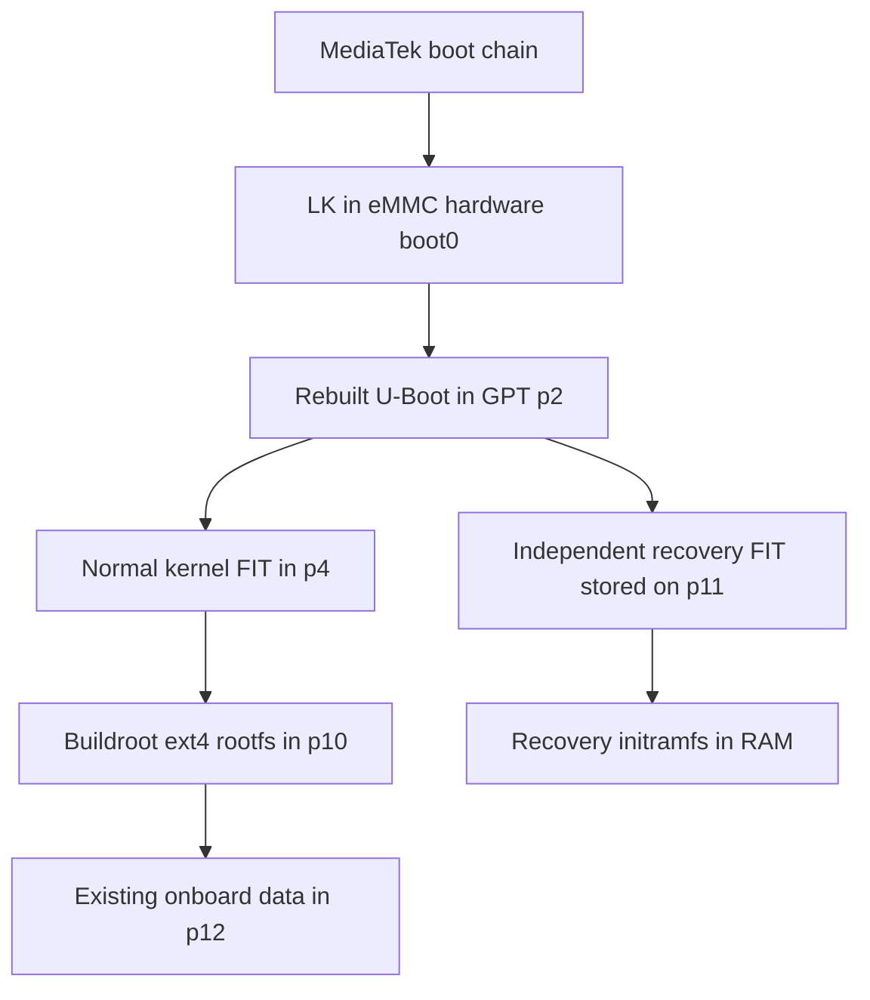

# Boot chain and independent recovery

Observed chain on our N365B:

## Measured storage roles

| Region | Role on this unit | Treatment during rootfs installation |
|---|---|---|
| hardware boot0 | Active LK | Previously patched/backed up; preserved during system transaction |
| p1 / bl2 | Captured contents zero | Not used as the active LK copy |
| p2 / UBOOT | U-Boot FIT | Recovery selector already installed; preserved |
| p3 / nvram | Device radio state | No raw rewrite |
| p4 / boot_a | Normal kernel FIT, 48 MiB partition | Whole-partition payload verified; tail outside FIT retained |
| p5 / tee_a | Secure-world image | Preserved |
| p6 / hwcfg | Hardware configuration | Preserved |
| p7 / ntxfw | NTX firmware | Preserved |
| p8 / waveform | E-ink assets | Mounted read-only, no journal replay for runtime assets |
| p9 / vendor | Vendor partition | Preserved |
| p10 / system_a | Root filesystem, 1 GiB | Replaced with verified ext4 image |
| p11 / recovery | Recovery storage, 1 GiB | Existing independent recovery retained |
| p12 / userdata | Onboard books/notes and staged payloads | Retained; no format |

Confirm your own layout and sizes. A device name or GPT label alone is not
sufficient evidence that an image belongs there.

## LK / U-Boot provenance

The LK technique follows the
[kos patcher](https://github.com/koreader-os/installer/blob/616f152b3276e6751eb2a7ce3a4dfde82ff67a64/patch-lk/main.rs):
change a conditional branch and recompute the GFH-region digest. Our preparation
required an exact original-image hash and one matching instruction sequence.
The U-Boot configuration follows the
[kos FIT-signature change](https://github.com/koreader-os/u-boot/commit/bdd69414357ce5dff357d48a33ebe64cbcfeeef6).
Component SHA-256 checks remain useful integrity checks; they do not restore
signature authentication after signature enforcement has been disabled.

## Entry and transport

On our installed selector, start with the reader actually off. Unplug USB for
about ten seconds. Hold Power, insert the known-good data cable, and release
Power after about three seconds. Timing and state matter; a forced reset and
normal reboot are different from shutdown. This describes our custom selector,
not a guaranteed stock recovery sequence.

Recovery exposes USB RNDIS at `192.168.77.2/30`; configure the host as
`192.168.77.1/30`. ACM provides an out-of-band identity channel. Pin the SSH host
key learned from that channel; the independent recovery and installed system
have different identities. An old stock SSH known_hosts entry can therefore
conflict after installing a new system. Verify the new identity over the trusted
USB path before replacing only the affected known_hosts entry.

The recovery menu and log viewer use the power button; touch is not required.
Its initial frontlight default is off, which makes the otherwise working screen
hard to see at night. A safe dim default remains a follow-up improvement.

## Recovery installer boundary

The tested backend uses staged files and explicit check/commit/rollback modes.
It checks board/layout, device CID, current recovery boot, power/battery,
mount state, payload hashes and protected boot/recovery regions. Dirty writes
trigger verified rollback; rollback failure leaves recovery running and does
not reboot automatically. The on-screen update-package browser and generic
update/state migration are not implemented yet.
